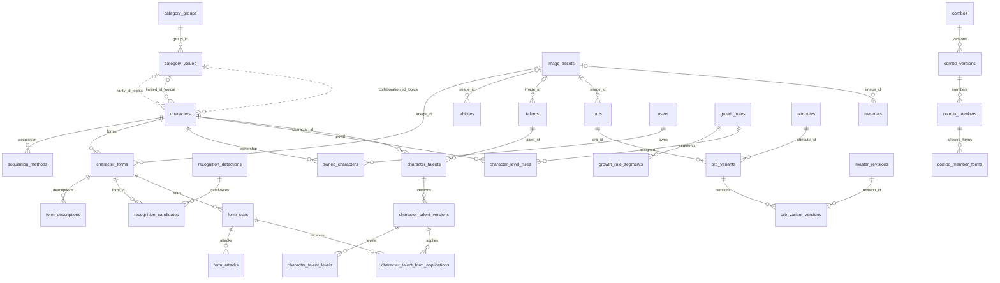

# NyankoSimulator テーブル定義書

**論理設計 v2 — 2026-09-19更新**

DB製品未選定。今回の更新は定義書のみで、既存CSV・画像・Pythonコードは変更していません。

## 読み方

VS Codeでこのファイルを開き、**⌘＋Shift＋V** でプレビュー表示してください。
各章は1テーブルずつ「論理名 / 物理名 / 型 / 制約・用途」の縦長の表にしています。
テーブル定義の書式は常に「論理名 / 物理名 / 型 / 制約・用途」の順で記載し、意味が分かる日本語の論理名を付与します。物理名は[共通ルール](database/00-common.md)の命名規則に従います。

## 章一覧

| 章                                           | 内容                                             |
| -------------------------------------------- | ------------------------------------------------ |
| [共通ルール](database/00-common.md)          | 型・キー・共通区分参照・版管理・計算値の方針     |
| [キャラ・形態・画像](database/01-master.md)  | 共通区分、名前、略称、解説、表示・照合共通の形態画像 |
| [取り込み・照合](database/02-recognition.md) | スクショと切り出し、候補順位、4段階の判定        |
| [ユーザー・所持・編成](database/03-users.md) | レベル、本能、玉、お宝・施設の育成状態           |
| [ステータスの元データ](database/04-stats.md) | 基礎値、成長率、単位、DPSの計算方針              |
| [特性・本能・コンボ](database/05-effects.md) | 効果、本能の適用形態、コンボの必要キャラと形態   |
| [入手・進化条件](database/06-conditions.md)  | キャラ入手と形態解放を分ける                     |
| [敵・ステージ](database/07-stages.md)        | 将来の推薦・攻略実績向け拡張案                   |
| [CSV移行対応](database/08-migration.md)      | 現行データからの移行先                           |

共通区分のマスタデータは[共通区分マスタデータ](database/category-master-data.md)に分けて記載しています。

## 全体の関係

図は主要部分のみ。代表略称はcharacters / character_formsの属性として直接保持し、独立したテーブル・リレーションは設けません。category_groups → category_valuesはgroup_idのFK。category_values → charactersの3本の破線は通常のFKを表さず、カラムごとに固定したグループ内のvalue_idを参照する論理関係を表します（rarity_id: rarity / 001、limited_id: limited / 002、collaboration_id: collaboration / 003）。各区分は未確認ならNULL可です。各マスターのimage_idはNULL可で、1対象につき画像は最大1枚（画像側の記号は0または1）です。認識候補は形態を直接参照し、形態のimage_idを通して表示と共通の画像に対応します。

## 今回反映した内容

略称管理を簡素化し、系列全体の代表略称をcharacters.character_short_name、特定形態の代表略称をcharacter_forms.form_short_nameに直接保持します。略称用の別テーブルは設けません。両カラムは任意の文字列で、各最大1つ、存在しない・未確認ならNULLとし、同じ値も許可します。今回の変更は略称管理と関連記述のみで、その他のテーブル構造は変更していません。

## 前回反映した内容

共通区分マスタcategory_groups / category_valuesを導入し、charactersのレア区分の参照先を変更、限定区分・コラボ区分を追加しました。characters / character_formsの有効フラグを削除しました。分類と入手経路を分離し、その他のテーブル構造は変更していません。

## これまでに反映した内容

1. 代表略称をcharacters.character_short_name（系列全体）/ character_forms.form_short_name（特定形態）に各最大1つ直接保持。存在しない・未確認ならNULLとし、複数の別名・検索語は管理しない。
2. 画像ファイルをimage_assetsに集約し、各マスターから任意のimage_idで直接参照。1対象につき最大1画像とし、形態の表示・照合画像を共通化。認識候補はform_idで形態を参照。
3. 本能の適用形態をcharacter_talent_form_applicationsで明示。
4. にゃんコンボ・解説・入手・進化条件を具体化。
5. ステータスは補正前基礎値・レベル帯ごとの成長率・補正ルールを保存。最終体力・攻撃力・DPSは計算。
6. お宝・施設などのユーザー状態を保存し、未設定を最大値と仮定しない。
7. 後半の横長一覧を廃止し、1テーブルずつの定義へ分割。

## テーブル一覧

### キャラ・形態・画像マスター

| テーブル            | 用途                                                   |
| ------------------- | ------------------------------------------------------ |
| `category_groups` | 区分グループ（レア・限定・コラボ）   |
| `category_values` | グループごとの区分値   |
| `characters`        | キャラクター（正式名称・系列全体の代表略称）             |
| `character_forms`   | 形態（正式名称・特定形態の代表略称）                     |
| `form_descriptions` | 形態解説                                              |
| `sources`           | 出典                                                   |
| `image_assets`      | 画像（システム全体で共通、用途分類なし）        |
| `master_revisions`  | 版                                                |

### 画像取り込み・照合履歴

| テーブル                 | 用途                       |
| ------------------------ | -------------------------- |
| `recognition_runs`       | 実行                   |
| `recognition_inputs`     | 入力                   |
| `recognition_detections` | 検出                 |
| `recognition_candidates` | 形態を直接参照する候補   |

### ユーザー・所持・編成

| テーブル               | 用途                     |
| ---------------------- | ------------------------ |
| `users`                | ユーザー                |
| `owned_characters`     | 所持キャラクター           |
| `owned_forms`          | 解放済み形態             |
| `formations`           | 編成                     |
| `formation_slots`      | 編成枠                   |
| `owned_talents`        | 所持本能            |
| `equipped_orbs`        | 装着本能玉             |
| `user_modifier_states` | ユーザー補正状態     |

### ステータス計算の元データ

| テーブル                | 用途                     |
| ----------------------- | ------------------------ |
| `calculation_specs`     | 計算基準             |
| `growth_rules`          | 成長ルール              |
| `growth_rule_segments`  | 成長ルール区間        |
| `character_level_rules` | キャラクターレベルルール |
| `form_stats`            | 形態ステータス           |
| `form_attacks`          | 形態攻撃           |

### 特性・本能・本能玉・コンボ・補正

| テーブル                   | 用途                     |
| -------------------------- | ------------------------ |
| `attributes`               | 属性 |
| `abilities`                | 特性・能力 |
| `form_abilities`           | 形態特性・能力 |
| `form_ability_targets`     | 形態特性・能力対象属性 |
| `talents`                  | 本能 |
| `character_talents`        | キャラクター本能 |
| `character_talent_versions` | キャラクター本能版 |
| `character_talent_levels`  | キャラクター本能レベル |
| `character_talent_form_applications` | キャラクター本能形態適用 |
| `orbs`                | 本能玉 |
| `orb_variants`                     | 本能玉バリエーション |
| `orb_variant_versions`             | 本能玉バリエーション版 |
| `form_orb_slots`           | 形態本能玉枠             |
| `combos`                   | にゃんコンボ             |
| `combo_versions`           | にゃんコンボ版       |
| `combo_members`            | にゃんコンボメンバー     |
| `combo_member_forms`       | にゃんコンボメンバー形態 |
| `modifier_definitions`     | 補正項目         |
| `modifier_versions`        | 補正項目版             |

### 入手・解放・進化条件

| テーブル              | 用途                   |
| --------------------- | ---------------------- |
| `condition_groups`    | 条件グループ            |
| `condition_items`     | 条件項目               |
| `materials`           | 素材            |
| `acquisition_methods` | 入手経路            |
| `evolution_rules`     | 進化ルール       |

### 敵・ステージ・攻略実績（拡張案）

| テーブル           | 用途               |
| ------------------ | ------------------ |
| `enemies`          | 敵キャラクター        |
| `enemy_stats`      | 敵キャラクターステータス  |
| `enemy_attributes` | 敵キャラクター属性       |
| `stage_maps`       | マップ             |
| `stages`           | ステージ           |
| `stage_variants`   | ステージバリエーション |
| `stage_spawns`     | 出現設定          |
| `battle_records`   | 攻略実績           |
